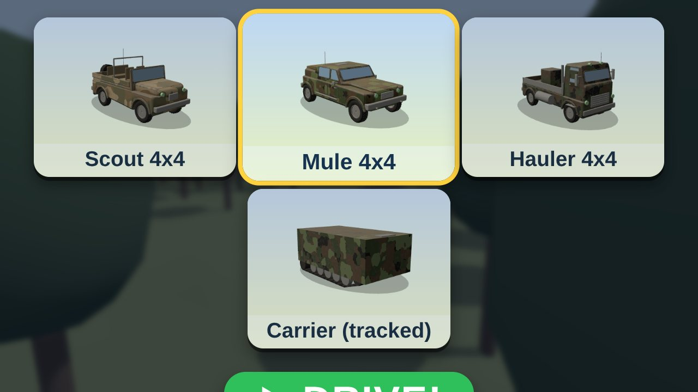
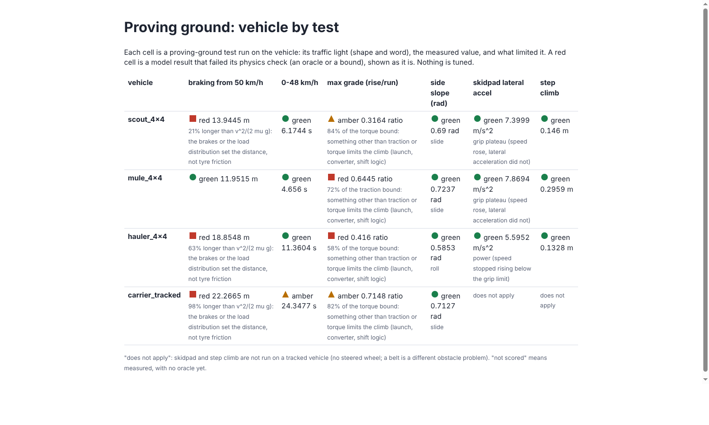
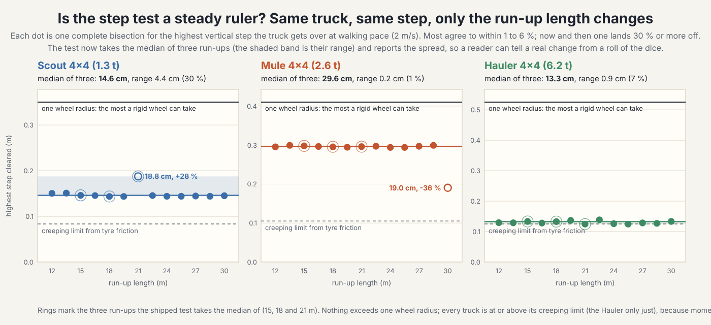
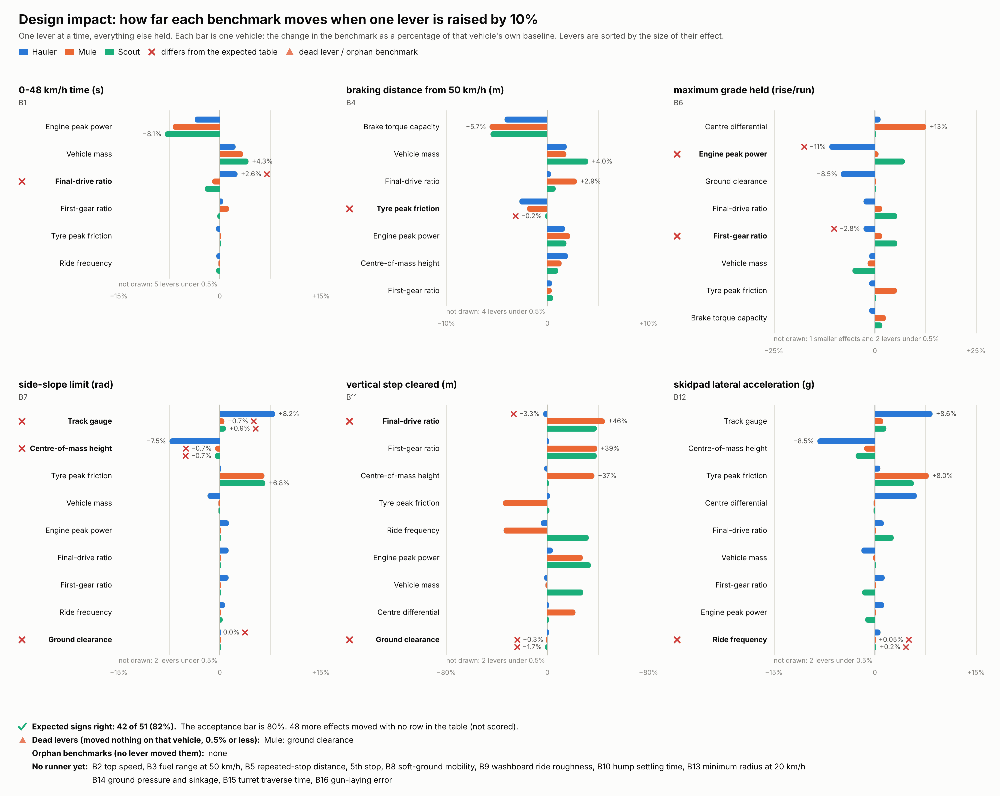

# Slice 2 report: "The Design Loop"

*ARCH, 2026-10-11, for the owner. Plain language. Numbers come from runs on `integration` (commands in the evidence column). The acceptance sentences are `docs/swarm/SLICE-2.md` section 6; the owner's later design direction is card C-020 and `docs/architecture/DESIGN-MODEL.md`.*

## The sentence we set out to make true
> Change a design lever, watch a real measurement move, and read why, for a truck and for the first tracked vehicle, on firm ground and in mud. Then drive the result.

**Verdict.**
- **True, end to end, for the three trucks.** In the Workshop you move a slider; the body reshapes in about half a second, the proving-ground scoreboard moves in two to three seconds, and DRIVE takes that exact vehicle onto the course.
- **True in part for the tracked carrier.** It drives (arrow keys, kid mode), finishes the course and the mud pit, and is measured on four of the six proving tests, plus the soil ladder and the pivot turn. It is **not in the Workshop yet**.
- **Two weak spots, both reported rather than hidden.** (1) The step-climb measurement: with one ray under each tyre the model cannot feel a step, so the number is noisy; it is reported with its noise and left out of the count. (2) The carrier's brakes are weak (red light) and, when strengthened, its nose dives and it somersaults from 0.7 g: a defect in the tracked model that the design loop itself found (below).

*The test-drive page's start screen now offers the tracked carrier beside the three trucks (the page was driven headless for this picture; the carrier drove at 28 km/h on the slice course).*

## Acceptance, sentence by sentence
| # | The sentence | State | Evidence, and the catch |
|---|---|---|---|
| 1 | The carrier finishes the course and the mud pit unaided; the Hauler is stopped by the pit walls; sinkage within 25 % of the soil theory | **met** | Test `the_carrier_finishes_the_course_and_the_mud_pit_unaided_while_the_hauler_stalls_on_the_pit_walls`: carrier 503.4 m in 73.6 s, Mule and Scout finish, the Hauler stalls at 180.4 m (the pit starts at 176 m). Sinkage against Bekker's formula on the track ladder (`w5k tracks bench ladder`): worst gap 1.2 % on clay, 1.8 % on sand, 23.9 % on snow at 150 t (the belly is then resting on the snow; below 60 t it is within 12 %). *Catch:* card C-019: with the published clay none of the trucks bogs on level ground, so the pit's 10 % walls do the separating; the soil numbers are secondary sources (`UNVERIFIED`, card C-017). |
| 2 | Pivot-turn moment within 25 % of `mu W L / 4`; the turn radius equals the kinematic value | **met** | TRACKS's spike S3: `pivot_turn_moment_equals_mu_w_l_over_4_on_firm_ground` reads +4.6 %; `skid_steer_turn_radius_follows_the_track_speeds` passes. |
| 3 | Impact Matrix: at least 80 % of expected signs right; every dead lever and orphan listed with a reason | **met, with a caveat** | `docs/lanes/validation/impact-v3.md`: **42 of 51 (82 %)** with unresolved cells left out; 53 of 65 (82 %) with every cell; 41 of 50 (82 %) without the step row; 55 of 69 (80 %) with nothing left out. Dead lever: the Mule's ground clearance. No orphan. *Catch:* only 23 of 53 table rows have a runner; 10 of 16 benchmarks (top speed, range, soft-ground mobility, ride roughness, ...) have none; and the **step row is not evidence either way** (see below). |
| 4 | The proving battery runs for every vehicle, an oracle or a source behind every light, an early end says why | **met** | Trucks: six tests each. Carrier: four (skidpad and step do not apply to a belt vehicle, and the runner and the grid say so). Every light has an oracle (VALIDATION's three new scorers, #188). Today's lights, not tuned: braking red for the Scout, the Hauler and the carrier (their brakes, not their tyres or tracks, set the distance; the Mule is green), gradeability amber for the Scout and the carrier, red for the Mule (72 % of its traction bound) and the Hauler (58 % of its torque bound): launch, converter and shift logic are DRIVE's questions; everything else green. *Catch:* the ride tests (ISO 8608 road, washboard) still have no runner, and every light is provisional while the published figures are unreachable (C-017). |
| 5 | Road and ground roughness inside their ISO 8608 class bands | **met (provisional)** | `w5k world stats` then `w5k validation terrain`: the main road falls as `n^-2.21` (class C), the ground between `n^-1.8` and `n^-2.4` (classes F and G); every roughness light is green. The class limits themselves are `UNVERIFIED` (C-017). |
| 6 | Workshop: change any of six levers, the body and scoreboard update in under 10 s, and the changed vehicle can be driven | **met for the trucks** | Each of the six sliders on the Hauler: design 0.5 to 0.6 s, scoreboard 1.6 to 3.5 s, DRIVE 0.7 to 0.8 s (`w5k viewer workshop`, timed end to end, also from the unzipped package). *Catch:* the carrier is not a Workshop base yet; the Mass slider is being replaced by choices (VIEWER, in review) because mass should come from the parts (C-020). |
| 7 | Hash chains identical on Linux and Windows; `integration` green; the Windows package downloads and runs | **checked by CI; the package needs you** | The first-light hash chain is compared on both systems at every merge, and `integration` is green. Package v3 is built by the Windows job (link below; that job was green, including the carrier's skin being packed). Its layout and the Workshop and drive servers were run from the unzipped Linux build here; **running it on Windows is yours**. |

*VALIDATION's grid: every light has its shape and word, its value and what limited it. Reds are model results that failed a physics check, shown as they are.*

## What the slice taught us (the useful part)
**1. Check the ruler before you read the difference.** The Impact Matrix compares a design with a nudged design. Its step-climb bench looked broken in a way that was a measurement problem, not a physics problem: changing the *run-up length* by 1.5 m, which should change nothing, moved the answer by 1 to 6 %, and about once in thirteen by 30 % (figure). A single ray under each tyre feels a step only when the wheel centre passes the edge, and then the ground jumps up under it: the tyre is punched upward, and whether the truck gets over depends on the phase of its bounce. So the bench now holds the speed with a proper controller, measures to half a millimetre, takes the median of three run-ups and reports its own spread; the matrix counts a change only if it is larger than twice that spread. In graphics terms: two renders of the same scene with a Monte Carlo path tracer are never identical, so you only believe a difference between two scenes once it exceeds the noise between two renders of one scene. The real fix (an enveloping tyre contact) is queued for CHASSIS.

**2. The design loop found a bug in the first tracked vehicle.** The obvious design move for a red braking light is stronger brakes. Sweeping FORGE's brake lever on the carrier: 0.47 g stops it in 29 m, the authored 0.62 g in 22 m with the nose dipping 18 degrees (the trucks dip 1 to 6), 0.68 g in 21 m with the nose down 35 degrees, and from 0.7 g the carrier turns end over end. The springs' statics say about 5 degrees at 0.75 g, and a rigid vehicle of its size would tip at 1.7 g, so the tracked hull or the belt contact is wrong, not the design. It is filed with the evidence for CHASSIS (`docs/swarm/requests/arch-chassis-tracked-braking-pitch.md`) and pinned by a red test that is ignored until it is fixed. This is exactly what a design loop is for: a slider pushed past the authored value exposes the model, not only the design.

**3. The matrix is steady without the step row.** 41 of 50 right (82 %) both before and after the bench change, so the part of the model that can be measured is behaving: engine power moves acceleration and mass, brake capacity moves stopping distance, track gauge moves side-slope and cornering limits, and the mass of a bigger engine now shows up in braking and cornering.

**4. A design is an assembly, and its weight comes from its parts** (your C-020). FORGE's component mass budget is merged: engine power now changes the vehicle's mass, balance and inertia. What is still to come: the audit of derived numbers and flags, the read-only Consequences panel in the Workshop, and the armour and weapon prices.

## Not true yet (so nobody is surprised)
- Published figures are unreachable from the lane sessions, so every "validated" light is "consistent with first principles" (card C-017 has the options).
- The carrier's brakes are weak (content for FORGE and DRIVE) and its hull pitches too far under braking (the request to CHASSIS above); it is not in the Workshop; it has no step or turn bench of its own.
- Ride quality, top speed, range, soft-ground mobility and combat benchmarks have no runner.
- The Workshop has no consequences panel and no hit map yet; the vulnerability model (weak points that cannot be armoured, an engine over 100 %) is designed (`DESIGN-MODEL.md`) but not built.

## Try it
Download the package (Windows): the artifact **`Warzone5000-TestDrive-windows`** (4.3 MB) of `integration` run 38099600024, commit `29f45cb`: https://github.com/Garsondee/warzone-5000/actions/runs/38099600024 (scroll to "Artifacts"; direct link, GitHub login needed: https://github.com/Garsondee/warzone-5000/suites/103227822159/artifacts/11687950399). Every later `integration` run carries the same artifact; from the run that follows this report on, the Windows job also unzips the package and starts the drive server and the Workshop itself before it keeps the zip (`tools/ci/smoke_package.py`). Unzip it anywhere, then:
- **START.bat**: the full-speed test drive (no speed limit); pick a vehicle from the pictures, DRIVE.
- **START-KID.bat**: the same with the 25 km/h cap for your son. The tracked carrier is in the picker; left and right run its two tracks at different speeds.
- **START-WORKSHOP.bat**: the Workshop. If the browser does not open, go to http://127.0.0.1:8789/.
A note of what your son found hard is worth more than any tuning I can do blind.

## Decisions waiting for you (defaults in force, nothing blocked)
C-017 (sources of published figures), C-018 (oracle tolerance 10 % and 20 %), C-019 (the clay and the pit walls), C-021 (design-model details), C-022 (the roster after slice 2). One setup item: add `"mcp__claude-code-remote__send_message",` to `permissions.allow` in `.claude/settings.json` so lanes can message ARCH.
